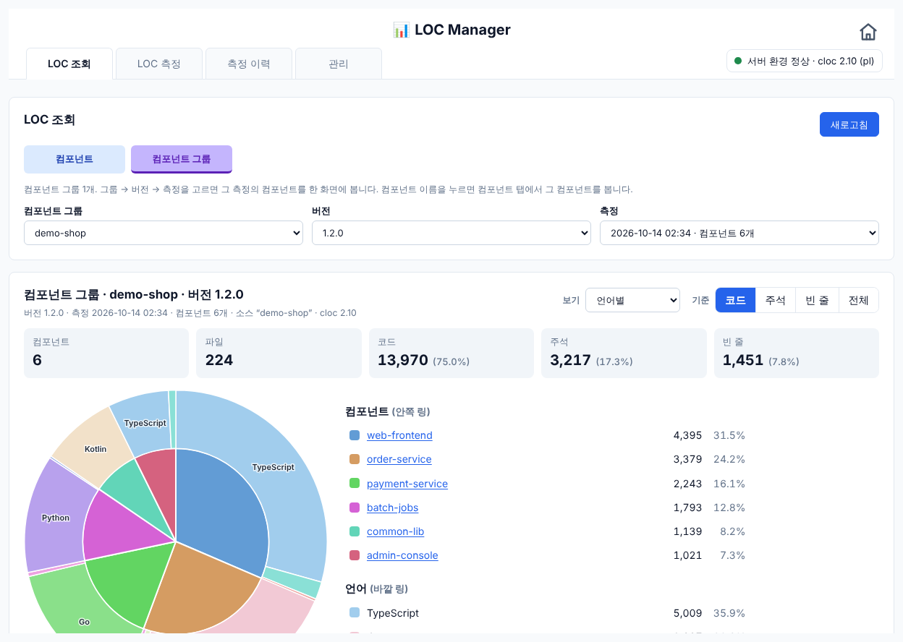
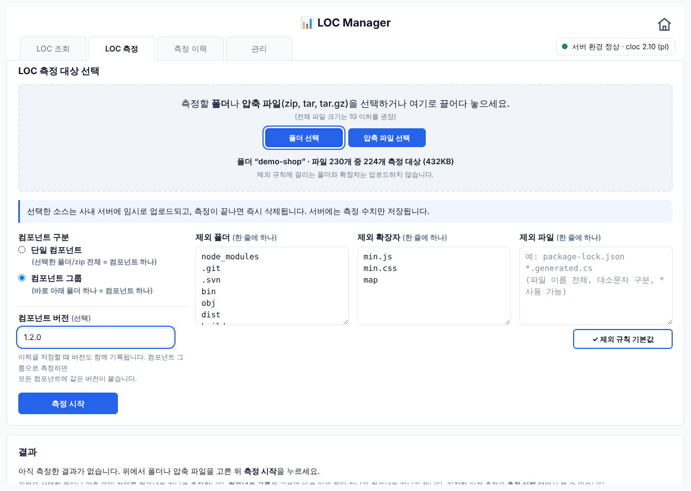
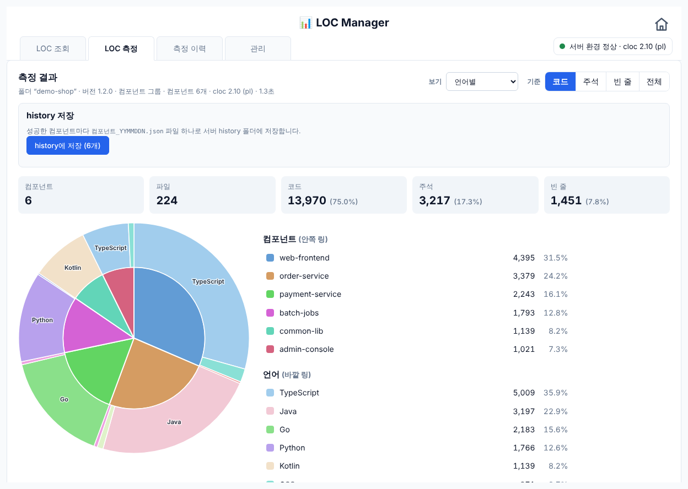
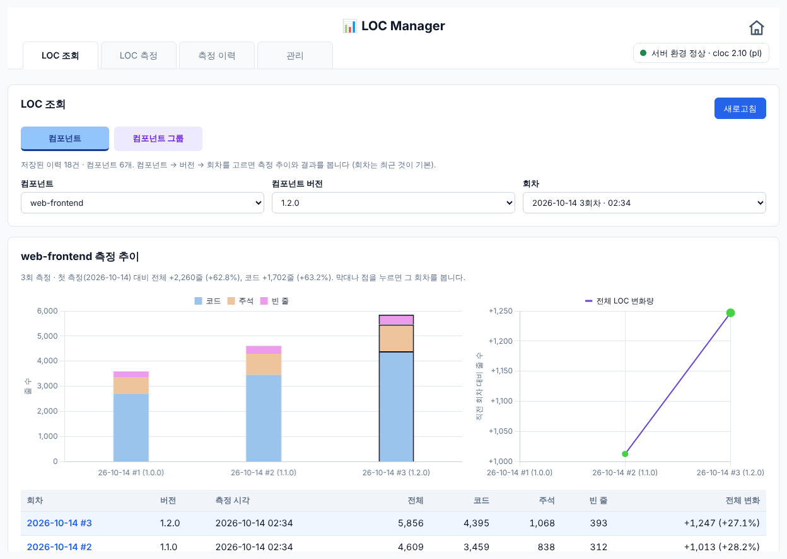
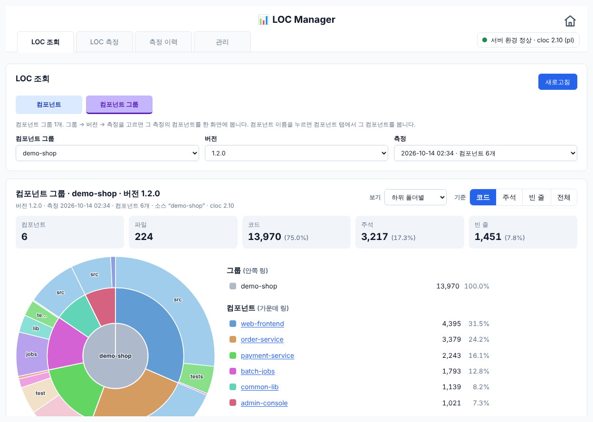
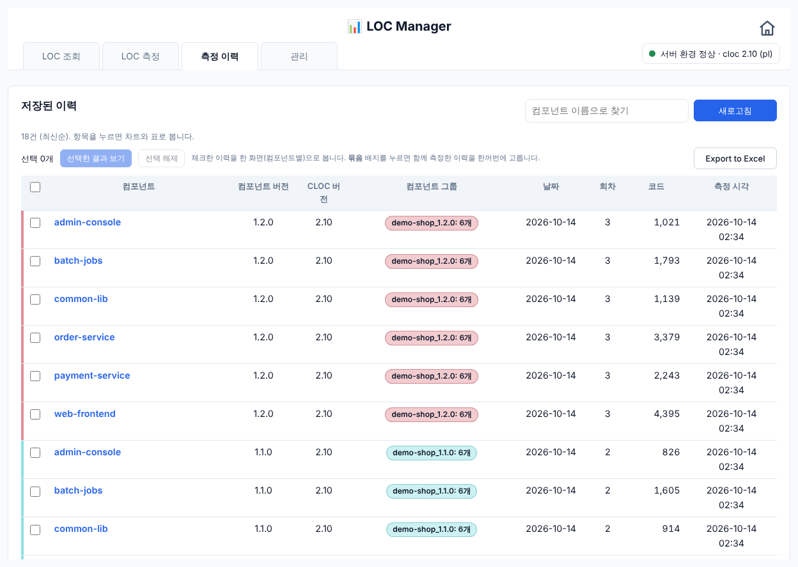
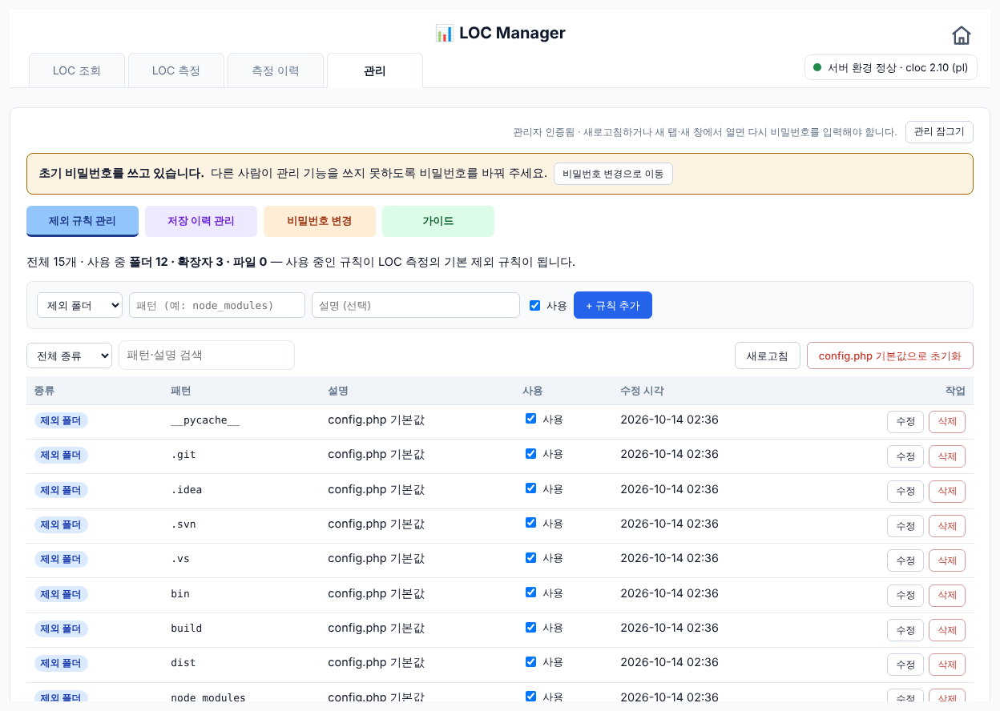
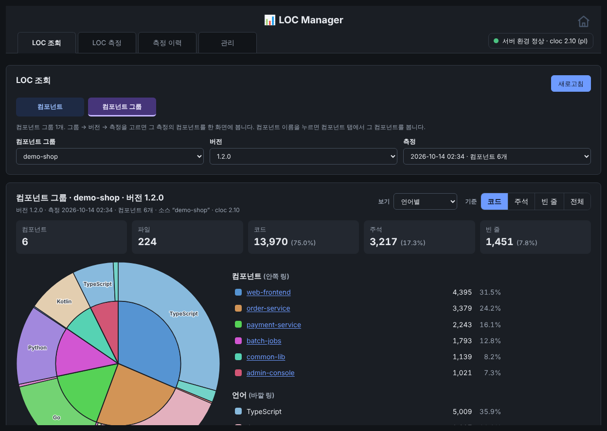
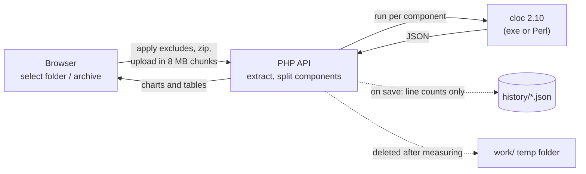

<div align="center">

# 📊 LOC Manager

**A self-hosted web tool that measures lines of code per component and keeps the history**

Pick a folder or an archive in the browser. The server runs [cloc](https://github.com/AlDanial/cloc) on each component,<br>
shows code, comment and blank lines as charts and tables, and records history and per-version trends.

[](https://github.com/resious71/LOC_Manager/actions/workflows/ci.yml)
[](LICENSE)


[한국어](README.md) · **English**

[Features](#-features) · [Screenshots](#-screenshots) · [Quick start](#-quick-start) · [How it works](#-how-it-works) · [Docs](#-documentation) · [Contributing](#-contributing)



</div>

> The user interface and the detailed guide are in Korean.

## ✨ Features

- **Measure folders or archives** — select or drag and drop a folder, or a zip / tar / tar.gz file. Korean (non-ASCII) file and folder names, including CP949 zips, are handled.
- **Per-component measurement** — treat the whole source as one component, or every immediate subfolder as its own component (component group), in a single run.
- **Charts at a glance** — a two-ring pie chart (components inside; languages, subfolders or file types outside) plus a table. Switch the basis between code, comment, blank and total lines.
- **History and trends** — save results with a version as JSON files, then follow growth with per-run stacked bars and a change-over-previous-run line chart.
- **Query view** — browse saved measurements per component or per component group, including a three-ring group → component → subfolder chart.
- **Excel export** — download the current table or the whole history as a formatted `.xlsx`.
- **Exclude rules** — manage folder, extension and file patterns (`node_modules`, `.git`, `*.min.js`, …) from the admin screen.
- **Easy to deploy** — copy the folder into XAMPP (Apache + PHP). No database, no Composer, no build step and no CDN, so it works on an **offline intranet**.
- **Safe by design** — uploaded sources are deleted right after measuring and only line counts are stored. Zip slip and zip bomb protection, a bcrypt admin password and a built-in server environment check are included.
- **Light and dark themes** following the OS setting.

## 🖼 Screenshots

| Measure — select source | Measure — result |
|:---:|:---:|
|  |  |
| **Query — component trend** | **Query — group / component / subfolder rings** |
|  |  |
| **History** | **Admin — exclude rules** |
|  |  |

<details>
<summary>Dark theme</summary>
<br>

</details>

> The numbers come from a real measurement of `demo-shop`, a fictional project generated for the demo.

## 🚀 Quick start

**Requirements**: [XAMPP for Windows](https://www.apachefriends.org/) (Apache 2.4 + PHP 8.1 or later). cloc is bundled.

1. Put the repository under XAMPP's `htdocs`.
   ```powershell
   cd C:\xampp\htdocs
   git clone https://github.com/resious71/LOC_Manager.git LOC_Mgmt
   ```
   Without Git, [download the ZIP](https://github.com/resious71/LOC_Manager/archive/refs/heads/main.zip) and extract it to `C:\xampp\htdocs\LOC_Mgmt`.
2. Check these settings in `C:\xampp\php\php.ini`, then restart Apache.
   ```ini
   extension=zip            ; remove the leading ; (disabled by default in XAMPP)
   upload_max_filesize=16M
   post_max_size=16M
   ```
3. Open `http://localhost/LOC_Mgmt/`. When the top-right badge says **서버 환경 정상** (environment OK), you are ready. Otherwise the problem and its fix are shown right there.
4. Open the **관리** (Admin) tab with the initial password `admin` and change it immediately under **비밀번호 변경** (Change password).

See the [installation and usage guide](docs/GUIDE.md) (Korean) for folder permissions, Apache access control, upgrading cloc and more.

## ⚙ How it works



| Part | Technology |
|---|---|
| UI | HTML + vanilla JavaScript (no build step), [Chart.js](https://www.chartjs.org/) 4.5, [JSZip](https://stuk.github.io/jszip/) 3.10, bundled in `lib/` |
| Server | PHP 8.1+ (no framework, no Composer); internal folders blocked with Apache `.htaccess` |
| Counting | [cloc](https://github.com/AlDanial/cloc) 2.10, bundled in `ctool/`; Windows exe first, Perl as a fallback |
| Storage | JSON files in `history/`, no database (paths and source code are never stored) |

## 📚 Documentation

| Document | Contents |
|---|---|
| [Installation and usage guide](docs/GUIDE.md) (Korean) | Setup, `php.ini`, permissions, UI, API, `config.php` |
| [CHANGELOG.md](CHANGELOG.md) | Release notes |
| [CONTRIBUTING.md](CONTRIBUTING.md) | Development setup, tests, code rules, pull requests |
| [SECURITY.md](SECURITY.md) | Reporting vulnerabilities, deployment notes |

## 🤝 Contributing

Bug reports, feature requests and pull requests are welcome, in English or Korean. Please read [CONTRIBUTING.md](CONTRIBUTING.md) first. Everyone taking part follows the [Code of Conduct](CODE_OF_CONDUCT.md).

```bash
php tests/run.php   # exit code 0 = all tests passed
```

## 🔒 Security

LOC Manager is designed for **intranet use only**. Do not expose it directly to the internet, and change the admin password right after installing. Report vulnerabilities privately as described in [SECURITY.md](SECURITY.md).

## 📄 License

[MIT License](LICENSE) © 2026 resious71

Bundled third-party software keeps its own license: cloc (`ctool/`, GPL v2 or later), Chart.js and JSZip (`lib/`, MIT). See [THIRD_PARTY_NOTICES.md](THIRD_PARTY_NOTICES.md).
