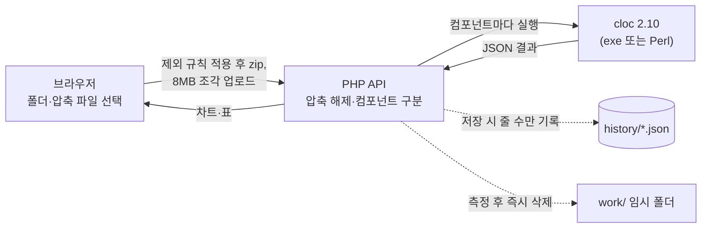

<div align="center">

# 📊 LOC Manager

**컴포넌트별 코드 규모(LOC)를 측정하고 이력으로 관리하는 셀프 호스팅 웹 도구**

폴더나 압축 파일을 고르면 서버가 [cloc](https://github.com/AlDanial/cloc)으로 컴포넌트마다 코드·주석·빈 줄을 세고,<br>
차트와 표로 보여주고, 측정 이력과 버전별 추이를 남깁니다.

[](https://github.com/resious71/LOC_Manager/actions/workflows/ci.yml)
[](LICENSE)


**한국어** · [English](README.en.md)

[주요 기능](#-주요-기능) · [화면](#-화면) · [빠른 시작](#-빠른-시작) · [동작 방식](#-동작-방식) · [문서](#-문서) · [기여](#-기여)


</div>

## ✨ 주요 기능

- **폴더·압축 파일 측정** — 브라우저에서 폴더를 고르거나 끌어다 놓으면 끝입니다. zip, tar, tar.gz 를 지원하고, 한글 폴더·파일 이름(CP949 zip 포함)도 그대로 측정합니다.
- **컴포넌트 단위 측정** — 소스 전체를 컴포넌트 하나로, 또는 바로 아래 폴더 하나를 컴포넌트 하나로(컴포넌트 그룹) 나눠 한 번에 측정합니다.
- **한눈에 보는 차트** — 안쪽 링은 컴포넌트, 바깥 링은 언어·하위 폴더·파일 타입인 두 겹 원형 차트와 표. 기준(코드/주석/빈 줄/전체)을 바꿔 볼 수 있습니다.
- **측정 이력과 추이** — 측정 결과를 버전과 함께 JSON 으로 저장하고, 회차별 막대 차트와 변화량 그래프로 성장 추이를 봅니다.
- **LOC 조회** — 컴포넌트별 또는 컴포넌트 그룹별로 저장된 측정을 골라 봅니다. 그룹은 그룹 → 컴포넌트 → 하위 폴더의 세 겹 차트로도 볼 수 있습니다.
- **Excel 내보내기** — 화면의 표나 이력 전체를 서식이 적용된 `.xlsx` 로 내려받습니다.
- **제외 규칙 관리** — `node_modules`, `.git`, `*.min.js` 같은 폴더·확장자·파일 패턴을 관리 화면에서 켜고 끕니다.
- **설치가 간단함** — XAMPP(Apache + PHP)에 폴더를 복사하면 됩니다. 데이터베이스, Composer, 빌드 과정, 외부 CDN 이 필요 없어 **인터넷이 안 되는 사내망**에서도 동작합니다.
- **안전한 처리** — 업로드한 소스는 측정이 끝나면 바로 지우고 줄 수만 저장합니다. zip slip·zip bomb 방어, 관리자 비밀번호(bcrypt), 화면에서 바로 보는 서버 환경 점검을 갖췄습니다.
- **밝은/어두운 테마** — 운영체제 설정을 따릅니다.

## 🖼 화면

| LOC 측정 — 대상 선택 | LOC 측정 — 결과 |
|:---:|:---:|
|  |  |
| **LOC 조회 — 컴포넌트별 측정 추이** | **LOC 조회 — 그룹·컴포넌트·하위 폴더 (3겹 차트)** |
|  |  |
| **측정 이력** | **관리 — 제외 규칙** |
|  |  |

<details>
<summary>어두운 테마</summary>
<br>

</details>

> 화면의 수치는 데모용으로 만든 가상 프로젝트 `demo-shop` 을 실제로 측정한 결과입니다.

## 🚀 빠른 시작

**요구 사항**: [XAMPP for Windows](https://www.apachefriends.org/) (Apache 2.4 + PHP 8.1 이상). cloc 은 저장소에 함께 들어 있습니다.

1. 저장소를 받아 XAMPP 의 `htdocs` 아래에 둡니다.
   ```powershell
   cd C:\xampp\htdocs
   git clone https://github.com/resious71/LOC_Manager.git LOC_Mgmt
   ```
   Git 이 없으면 [ZIP 으로 내려받아](https://github.com/resious71/LOC_Manager/archive/refs/heads/main.zip) `C:\xampp\htdocs\LOC_Mgmt` 에 풀어도 됩니다.
2. `C:\xampp\php\php.ini` 에서 다음을 확인하고 Apache 를 다시 시작합니다.
   ```ini
   extension=zip            ; 앞의 ; 를 지웁니다 (XAMPP 기본값은 꺼져 있음)
   upload_max_filesize=16M
   post_max_size=16M
   ```
3. 브라우저에서 `http://localhost/LOC_Mgmt/` 를 엽니다. 오른쪽 위에 **서버 환경 정상** 이 보이면 준비가 끝났습니다. 문제가 있으면 원인과 해결 방법이 그 자리에 표시됩니다.
4. **관리** 탭에 초기 비밀번호 `admin` 으로 들어가 **비밀번호 변경** 에서 바로 바꿔 주세요.

폴더 권한, Apache 접근 제한, cloc 버전 올리기 같은 자세한 내용은 [설치·사용 가이드](docs/GUIDE.md)를 보세요.

## ⚙ 동작 방식



| 구성 | 사용 기술 |
|---|---|
| 화면 | HTML + 순수 JavaScript (빌드 과정 없음), [Chart.js](https://www.chartjs.org/) 4.5, [JSZip](https://stuk.github.io/jszip/) 3.10 — 모두 `lib/` 에 포함 |
| 서버 | PHP 8.1+ (프레임워크·Composer 없음), Apache `.htaccess` 로 내부 폴더 차단 |
| 측정 | [cloc](https://github.com/AlDanial/cloc) 2.10 — `ctool/` 에 포함, Windows exe 우선, 안 되면 Perl 로 실행 |
| 저장 | 데이터베이스 없이 `history/` 폴더의 JSON 파일 (경로·소스 내용은 저장하지 않음) |

## 📚 문서

| 문서 | 내용 |
|---|---|
| [설치·사용 가이드](docs/GUIDE.md) | 설치, `php.ini`, 폴더 권한, 화면 사용법, API, `config.php` 설정값 |
| [CHANGELOG.md](CHANGELOG.md) | 버전별 변경 사항 |
| [prd.md](prd.md) | 요구사항 명세 |
| [CONTRIBUTING.md](CONTRIBUTING.md) | 개발 환경, 테스트, 코드 규칙, PR 방법 |
| [SECURITY.md](SECURITY.md) | 취약점 신고 방법과 운영 시 주의 사항 |

## 🤝 기여

버그 제보, 기능 제안, Pull Request 모두 환영합니다. 시작하기 전에 [CONTRIBUTING.md](CONTRIBUTING.md) 를 읽어 주세요. 모든 참여자는 [행동 강령](CODE_OF_CONDUCT.md)을 따릅니다.

```bat
:: 테스트 (종료 코드 0 = 모두 통과)
C:\xampp\php\php.exe tests\run.php
```

## 🔒 보안

LOC Manager 는 **사내망 전용**으로 설계되었습니다. 인터넷에 직접 공개하지 말고, 설치 직후 관리자 비밀번호를 바꿔 주세요. 보안 취약점은 공개 이슈 대신 [SECURITY.md](SECURITY.md) 의 방법으로 알려 주세요.

## 📄 라이선스

[MIT License](LICENSE) © 2026 resious71

함께 배포하는 서드파티 소프트웨어는 각자의 라이선스를 따릅니다: cloc (`ctool/`, GPL v2 이상), Chart.js·JSZip (`lib/`, MIT). 자세한 내용은 [THIRD_PARTY_NOTICES.md](THIRD_PARTY_NOTICES.md) 를 보세요.
